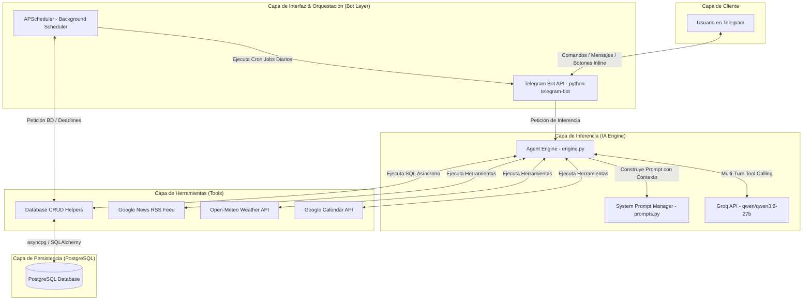
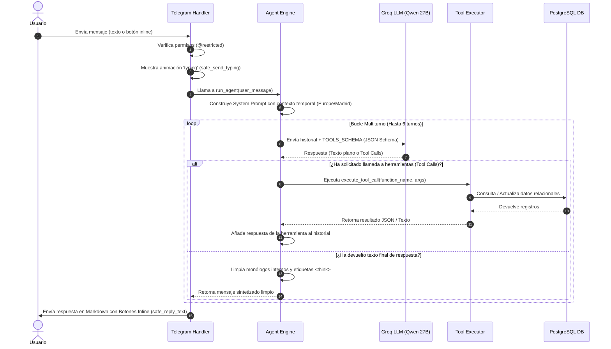
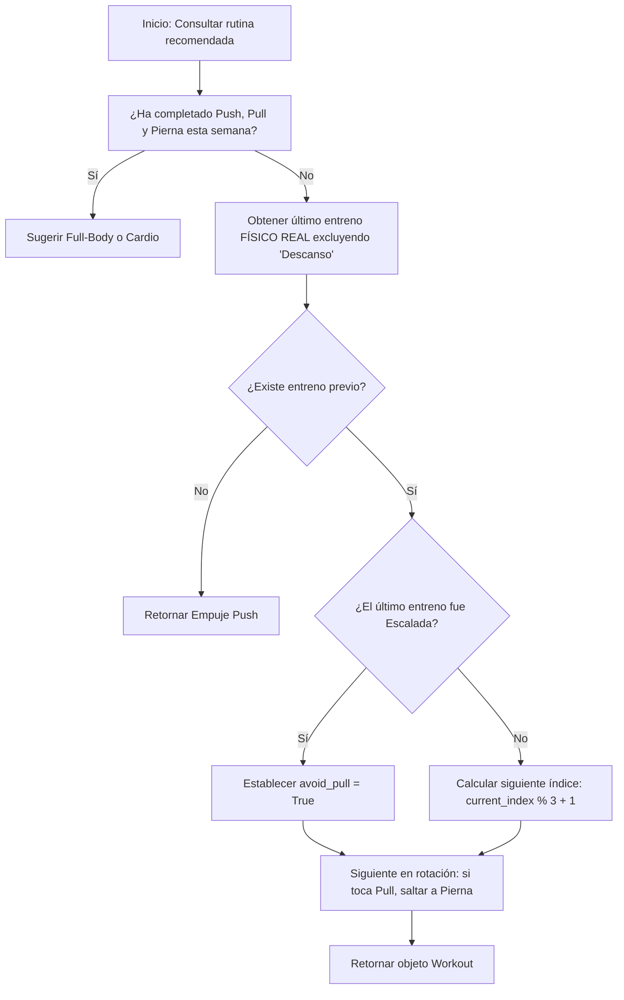

# 🛠️ Especificación Técnica y Arquitectura de Jarvis Personal Assistant

Este documento constituye la **guía técnica integral** y la especificación de diseño del sistema **Jarvis Personal Assistant**. Su propósito es proporcionar una comprensión completa, profunda y estructurada de la arquitectura del software, sus componentes internos, la gestión de datos, los algoritmos de inferencia y las automatizaciones en segundo plano.

---

## 📋 ÍNDICE DE CONTENIDOS

1. [Visión General del Sistema y Filosofía de Diseño](#1-visión-general-del-sistema-y-filosofía-de-diseño)
2. [Diagramas de Arquitectura y Flujos de Datos](#2-diagramas-de-arquitectura-y-flujos-de-datos)
3. [Estructura del Proyecto y Módulos](#3-estructura-del-proyecto-y-módulos)
4. [Análisis Detallado de Componentes (Fichero a Fichero)](#4-análisis-detallado-de-componentes-fichero-a-fichero)
   - 4.1 Punto de Entrada e Inicialización (`main.py` y `config/settings.py`)
   - 4.2 Persistencia y Modelado ORM (`database/`)
   - 4.3 Motor de Inteligencia Artificial y Multi-Turn Engine (`agent/`)
   - 4.4 Catálogo y Ejecución de Herramientas (`tools/`)
   - 4.5 Interfaz de Telegram y Gestión de Eventos (`bot/handlers.py`)
   - 4.6 Sistema de Automatizaciones y Cron Jobs (`bot/scheduler.py`)
5. [Algoritmos Clave y Reglas de Negocio](#5-algoritmos-clave-y-reglas-de-negocio)
   - 5.1 Algoritmo de Rotación Inteligente de Gimnasio
   - 5.2 Algoritmo Adaptativo de Avisos Aislados de Deadlines
   - 5.3 Optimización y Pre-recopilación Directa para el Comando `/hoy`
   - 5.4 Control de Pagos Individuales de Spotify Bizum
6. [Tolerancia a Fallos y Resiliencia de Red](#6-tolerancia-a-fallos-y-resiliencia-de-red)
7. [Infraestructura de Despliegue con Docker](#7-infraestructura-de-despliegue-con-docker)

---

## 1. 📌 VISIÓN GENERAL DEL SISTEMA Y FILOSOFÍA DE DISEÑO

**Jarvis** es un asistente personal inteligente que opera como un bot asíncrono de Telegram. Está desarrollado en **Python 3.12** empleando una **arquitectura por capas desarticulada (Layered Architecture)** basada en I/O no bloqueante (`asyncio`).

### Principios de Diseño:
- **Asincronía Total:** Todas las operaciones de red (Telegram API, Groq LLM, Google Calendar, Open-Meteo, Google News RSS) y base de datos (PostgreSQL vía `asyncpg`) son 100% asíncronas.
- **Determinismo en Datos Críticos:** Las decisiones estructurales (agenda, estado de pastilla, cobros de Bizum, rotación de ejercicios) no dependen del azar del LLM; los datos reales se extraen de la base de datos o APIs y se inyectan directamente al modelo para su síntesis.
- **Resiliencia de Red:** La aplicación está diseñada para sobrevivir a micro-cortes de Internet o latencias altas en las APIs externas sin interrumpir el bucle de polling ni tirar el contenedor en producción.

---

## 2. 📊 DIAGRAMAS DE ARQUITECTURA Y FLUJOS DE DATOS

### 2.1 Diagrama General de Componentes del Sistema



---

### 2.2 Diagrama de Secuencia: Flujo General de Procesamiento de Mensajes



---

### 2.3 Diagrama Gantt: Cronograma de Automatizaciones Diarias (Europe/Madrid)

```mermaid
gantt
    title Automatizaciones Diarias en Segundo Plano (APScheduler)
    dateFormat  HH:mm
    axisFormat %H:%M

    section Tareas Continuas
    Comprobación Aislada de Deadlines (cada 15m) :crit, 00:00, 24h

    section Avisos Programados
    Briefing Matutino (Noticias, Tiempo, Agenda)   :active, 07:30, 1m
    Segundo Aviso de Pastilla                      :active, 15:00, 1m
    Recordatorio de Gimnasio (L-V)                 :active, 20:00, 1m
    Check-in de Entrenamiento Nocturno (L-V)      :active, 22:00, 1m
    Chequeos Nocturnos (Pastilla, Oficina, Spotify):active, 23:00, 1m
```



---

## 3. 📂 ESTRUCTURA DEL PROYECTO Y MÓDULOS

```
jarvis-project/
├── agent/                      # Motor de inferencia y prompts
│   ├── engine.py               # Bucle multiturno de IA y ejecución de funciones
│   └── prompts.py              # Generador de System Prompt con fecha/hora dinámicas
├── bot/                        # Lógica de interfaz Telegram y temporizador
│   ├── handlers.py             # Comandos (/start, /hoy, /spotify, /entreno) y botones
│   └── scheduler.py            # Cron Jobs (07:30, 15:00, 20:00, 22:00, 23:00) y Deadlines
├── config/                     # Configuración centralizada
│   └── settings.py             # Carga y validación con Pydantic Settings
├── database/                   # Capa de base de datos relacional
│   ├── connection.py           # Configuración del motor Async Engine y AsyncSessionLocal
│   ├── models.py               # Modelos SQLAlchemy (Workouts, Deadlines, Spotify, etc.)
│   ├── crud.py                 # Lógica de negocio relacional y consultas SQL
│   └── seed.py                 # Migraciones automáticas y datos iniciales
├── tools/                      # Catálogo de herramientas para el LLM
│   ├── registry.py             # Esplicitación de esquemas JSON Schema para Tool Calling
│   ├── calendar_tools.py       # API de Google Calendar (OAuth2)
│   ├── workout_tools.py        # Adaptador para consultas de entrenamiento
│   ├── task_tools.py           # Adaptador para pastilla, tareas y Bizum Spotify
│   └── news_weather_tools.py   # Conectores con Open-Meteo y Google News RSS
├── DOCUMENTACION_TECNICA.md    # Especificación técnica detallada (este archivo)
├── README.md                   # Manual de usuario e instrucciones de despliegue
├── Dockerfile                  # Contenedor de producción en Python 3.12-slim
├── docker-compose.yml          # Orquestación de bot + PostgreSQL
├── requirements.txt            # Dependencias del proyecto
└── main.py                     # Punto de entrada de la aplicación
```

---

## 4. 🔍 ANÁLISIS DETALLADO DE COMPONENTES (FICHERO A FICHERO)

### 4.1 Punto de Entrada e Inicialización (`main.py` y `config/settings.py`)
- **`config/settings.py`**: Utiliza `pydantic-settings` para cargar y validar estrictamente las variables de entorno desde el archivo `.env` (`TELEGRAM_BOT_TOKEN`, `TELEGRAM_USER_ID`, `DATABASE_URL`, `GROQ_API_KEY`, `TIMEZONE="Europe/Madrid"`).
- **`main.py`**:
  - Configura el cliente HTTP subyacente con `HTTPXRequest(connect_timeout=30.0, read_timeout=30.0)` para prevenir desconexiones por latencia en las llamadas de polling a Telegram.
  - Asigna el hook `post_init` que arranca la base de datos (creando o migrando tablas con `init_models()` y `seed_data()`) e inicializa el scheduler (`start_scheduler()`).
  - Llama a `application.run_polling(bootstrap_retries=-1)`, activando un bucle de reintentos infinitos si la red de Telegram cae al inicio.

---

### 4.2 Persistencia y Modelado ORM (`database/`)

#### `database/connection.py`
Establece el pool de conexiones asíncronas con PostgreSQL mediante `create_async_engine(settings.database_url)` y genera la fábrica de sesiones `AsyncSessionLocal`.

#### `database/models.py` (Tablas Registradas):
1. **`Workout` (`workouts`)**: Almacena las rutinas base (`id`, `name`, `order_index`, `target_muscles`, `description`).
2. **`WorkoutLog` (`workout_logs`)**: Registro histórico de sesiones realizadas (`id`, `workout_id`, `completed_at`, `notes`, `rpe`).
3. **`PillLog` (`pill_logs`)**: Control de la toma diaria de la pastilla (`id`, `log_date`, `taken`, `confirmed_at`).
4. **`SpotifyPaymentTracker` (`spotify_payment_trackers`)**: Control mensual de pagos de Spotify (`id`, `month_key` YYYY-MM, `total_friends` [4], `paid_count`, `ruben_paid`, `victoriano_paid`, `miquel_paid`, `joan_paid`, `is_complete`, `last_reminded_at`).
5. **`OfficeSchedule` (`office_schedules`)**: Asistencia presencial a la oficina (`id`, `schedule_date`, `will_attend`, `user_notified_night_before`).
6. **`DeadlineTask` (`deadline_tasks`)**: Tareas puntuales con fecha y hora límite (`id`, `title`, `deadline`, `is_done`, `last_reminded_at`).
7. **`RecurringTask` (`recurring_tasks`)**: Tareas periódicas configurables.
8. **`EmailLog` (`email_logs`)**: Registro de trazabilidad y deduplicación de correos entrantes de Gmail (`id`, `message_id`, `sender`, `subject`, `received_at`, `is_promotional`, `is_important`, `alert_sent`, `night_summary_included`). Permite desacoplar el procesamiento diurno y nocturno bajo arquitectura Zero-PII sin almacenar cuerpos ni contenidos sensibles.

#### `database/seed.py`
Contiene la función `init_models()` que ejecuta automáticamente en cada inicio:
```sql
ALTER TABLE spotify_payment_trackers ADD COLUMN IF NOT EXISTS ruben_paid BOOLEAN DEFAULT FALSE;
ALTER TABLE spotify_payment_trackers ADD COLUMN IF NOT EXISTS victoriano_paid BOOLEAN DEFAULT FALSE;
ALTER TABLE spotify_payment_trackers ADD COLUMN IF NOT EXISTS miquel_paid BOOLEAN DEFAULT FALSE;
ALTER TABLE spotify_payment_trackers ADD COLUMN IF NOT EXISTS joan_paid BOOLEAN DEFAULT FALSE;
```
Esto garantiza que la base de datos se actualice automáticamente en despliegues sin perder información existente.

---

### 4.3 Motor de Inteligencia Artificial y Multi-Turn Engine (`agent/`)

#### `agent/prompts.py`
Genera el **System Prompt dinámico** entregado al modelo en cada petición:
- Inyecta la **fecha y hora actuales** traducidas al español (ej. `2026-08-22 (Sábado)` a las `15:45` en `Europe/Madrid`).
- Aplica reglas estrictas de formato (español castellano, emojis, prohibición absoluta de monólogos de planificación interna).

#### `agent/engine.py`
Contiene la función `run_agent(user_message, enable_tools=True)`:
- Envía el historial a Groq API con fallback dinámico multimodelo (`llama-3.3-70b-versatile`, `qwen-2.5-32b`, `llama-3.1-8b-instant`).
- Si `enable_tools=True`, adjunta `TOOLS_SCHEMA` y ejecuta las herramientas solicitadas (`tool_calls` o XML `<tool_call>`) llamando a `execute_tool_call()`.
- Si `enable_tools=False` (usado para síntesis del Briefing Matutino y `/hoy`), no adjunta herramientas para evitar llamadas innecesarias o vacías cuando los datos ya se encuentran en el prompt.
- Realiza hasta 6 iteraciones en bucle para encadenar llamadas si fuera necesario.
- Pasa el resultado final por `clean_think_tags()` para eliminar de forma segura monólogos internos `<think>` y bloques `<tool_call>` sin descartar listas numeradas ni viñetas.

#### `agent/email_classifier.py`
Módulo especializado en la clasificación y triage de correos electrónicos bajo el principio **Zero-PII**:
- **Filtro Determinista Local:** Si las cabeceras del correo indican publicidad (`List-Unsubscribe`, `Precedence: bulk` o etiquetas promocionales de Gmail), el correo se descarta de forma instantánea sin realizar llamadas a APIs externas.
- **Inferencia Metadata-Only:** En correos potencialmente importantes, envía al LLM (Groq API) **únicamente el remitente y el asunto** en formato JSON. Nunca se expone el cuerpo del correo.
- **Respaldo Heurístico de Alta Disponibilidad:** `evaluate_email_importance_heuristic()` evalúa palabras clave críticas ante caídas de red o límites de cuota de la IA para garantizar que ninguna notificación urgente se pierda.

---

### 4.4 Catálogo y Ejecución de Herramientas (`tools/`)

- **`tools/registry.py`**: Define la lista `TOOLS_SCHEMA` compatible con OpenAPI / JSON Schema conteniendo las 18 herramientas expuestas al LLM.
- **`tools/calendar_tools.py`**: Conecta con Google Calendar mediante OAuth2 (`credentials/token.json` y `credentials/credentials.json`) para consultar eventos del día o de la semana completa y crear nuevas citas. Incorpora wrappers asíncronos no bloqueantes (`get_day_events_async`, `get_week_events_async`, `create_calendar_event_async`) mediante `asyncio.to_thread` para preservar la reactividad del event loop de Telegram.
- **`tools/email_tools.py`**: Conector con Gmail API (v1) bajo scope de solo lectura (`gmail.readonly`). Implementa peticiones exclusivas con `format='metadata'` para obtener cabeceras técnicas (`From`, `Subject`, `Date`, `List-Unsubscribe`, `Precedence`) sin descargar jamás el cuerpo del correo de la red, garantizando privacidad estricta. Además, expone las herramientas conversacionales interactivas `check_important_emails_tool` y `get_recent_emails_summary_tool` con sincronización en vivo y consulta a la tabla `email_logs`.
- **`tools/news_weather_tools.py`**:
  - `get_weather_forecast()`: Consulta la API gratuita de Open-Meteo para obtener la predicción del día en Madrid (temperatura máxima, mínima, probabilidad de lluvia y código de estado WMO con emoji).
  - `get_top_news()`: Descarga y parsea el feed XML/RSS oficial de Google News España para obtener las 2-3 noticias principales del día con su título y fuente.
- **`tools/workout_tools.py`** y **`tools/task_tools.py`**: Adaptadores asíncronos que conectan las peticiones del agente con las funciones CRUD de la base de datos.

---

### 4.5 Interfaz de Telegram y Gestión de Eventos (`bot/handlers.py`)

- **`@restricted`**: Decorador de seguridad que comprueba si el `user_id` de Telegram coincide con el configurado en `.env`. Si no coincide, rechaza la petición y la registra en logs.
- **`safe_send_typing(chat)`**: Envía la acción visual de *"escribiendo..."* capturando excepciones de red para evitar caídas en caso de picos de latencia.
- **`safe_edit_message_text(query, text, reply_markup)`**: Manejador seguro para edición de mensajes inline con captura de errores de Markdown y excepciones de mensaje no modificado.
- **`build_spotify_status_and_keyboard(tracker)`**: Genera el texto con el estado del cobro del Spotify de Ruben, Victoriano, Miquel y Joan, creando **botones táctiles únicamente para los amigos pendientes de pago**.
- **`generate_hoy_summary()`**: Función optimizada que recopila todos los datos de forma no bloqueante (Weather, Noticias, BD, Calendar asíncrono) y llama al motor de IA con `enable_tools=False`. Si la IA falla, recurre a `format_fallback_hoy_summary()` para garantizar entrega al instante.
- **`global_error_handler`**: Captura errores de red no controlados a nivel global en la aplicación.

---

### 4.6 Sistema de Automatizaciones y Cron Jobs (`bot/scheduler.py`)

Almacena los trabajos programados con `APScheduler`:
1. **`deadline_checker_job` (cada 15 minutos)**: Evalúa tareas próximas a su vencimiento y envía recordatorios aislados con botón `[✅ Marcar como hecha]`.
2. **`morning_briefing_job` (07:30 AM)**: Briefing matutino completo con el tiempo, 2-3 noticias del día, agenda de Google Calendar (no bloqueante), gimnasio y estado de la pastilla. Los martes (o miércoles si aún no se ha decidido) incorpora la consulta interactiva de asistencia a la oficina (Jueves, Viernes, No iré o No lo sé). Incorpora un bucle de reintentos (hasta 3 intentos), invocación con `enable_tools=False` y respaldo determinista en Python (`format_fallback_morning_briefing`) para asegurar la entrega del mensaje con un 100% de fiabilidad.
3. **`afternoon_pill_job` (15:00 PM)**: Segundo aviso de verificación de pastilla si aún no se ha tomado.
4. **`gym_reminder_job` (20:00 PM L-V)**: Recordatorio del entrenamiento correspondiente hoy según la rotación inteligente.
5. **`nightly_gym_checkin_job` (22:00 PM L-V)**: Check-in de confirmación de entrenamiento (Hecho, Escalada o Descanso).
6. **`nightly_checks_job` (23:00 PM)**: Tercer aviso de pastilla, recordatorio de oficina para el día siguiente, control del Bizum de Spotify (a partir del día 16 de cada mes), resumen consolidado de correos del día (Zero-PII) y resumen mensual el último día del mes.
7. **`daytime_email_monitor_job` (cada 15 minutos, 08:00 - 20:45)**: Monitoreo continuo de la bandeja de entrada vía Gmail API. Clasifica mensajes no leídos con el motor Zero-PII (`agent/email_classifier.py`), registra en `EmailLog` para deduplicación y envía notificaciones push inmediatas con botón de acceso directo a Gmail en caso de correos prioritarios.


---

## 5. ⚡ ALGORITMOS CLAVE Y REGLAS DE NEGOCIO

### 5.1 Algoritmo de Rotación Inteligente de Gimnasio (`get_smart_next_workout_routine`)

El algoritmo determina la rutina adecuada evaluando el historial en PostgreSQL:



---

### 5.2 Algoritmo Adaptativo de Avisos Aislados de Deadlines

La función `deadline_checker_job` calcula la cuenta atrás $\Delta t = \text{deadline} - \text{ahora}$ para cada tarea pendiente:

$$\Delta t \le 0 \implies \text{Aviso de tarea vencida cada 1 hora}$$
$$0 < \Delta t \le 1\text{h} \implies \text{Aviso urgente cada 15 minutos}$$
$$1\text{h} < \Delta t \le 3\text{h} \implies \text{Aviso cada 45 minutos}$$
$$3\text{h} < \Delta t \le 6\text{h} \implies \text{Aviso cada 2 horas}$$
$$6\text{h} < \Delta t \le 24\text{h} \implies \text{Aviso cada 4 horas}$$
$$\Delta t > 24\text{h} \implies \text{Aviso aislado día sí, día no (cada 48 horas)}$$

- **Antispam:** Se registra `task.last_reminded_at` en PostgreSQL para respetar estrictamente los intervalos.
- **Borrado en 1-Clic:** Al pulsar `[✅ Marcar como hecha]`, se ejecuta `mark_deadline_task_completed()`, que borra físicamente la fila de la tabla `deadline_tasks`.

---

### 5.3 Optimización y Pre-recopilación Directa para el Comando `/hoy`

Para evitar latencias y cuotas de consumo (`HTTP 429` en la API de Groq), el comando `/hoy` no deja que el LLM decida qué herramientas llamar en cadena:
1. `generate_hoy_summary()` ejecuta en paralelo la recopilación de datos (PostgreSQL, Calendar, Open-Meteo, Google News).
2. Construye un prompt cerrado con todos los datos precargados.
3. Se realiza **1 sola petición a la API del LLM**, respondiendo al usuario en **~2 segundos**.

---

### 5.4 Control de Pagos Individuales de Spotify Bizum

En la tabla `spotify_payment_trackers`, se almacenan booleanos independientes:
- `ruben_paid`, `victoriano_paid`, `miquel_paid`, `joan_paid`.

La función `build_spotify_status_and_keyboard()` construye el mensaje con el desglose por amigo (`✅ Pagado` / `❌ Pendiente`) y genera **únicamente los botones de los amigos cuya casilla sea `False`**. Cuando un amigo paga, su botón desaparece automáticamente de la interfaz de Telegram.

---

## 6. 🛡️ TOLERANCIA A FALLOS Y RESILIENCIA DE RED

1. **Inmunidad a Timeouts de Red:** `main.py` configura `connect_timeout=30.0` y `read_timeout=30.0`.
2. **Bootstrapping Infinito:** `application.run_polling(bootstrap_retries=-1)` evita que la aplicación se cierre si hay cortes de conexión con los servidores de Telegram en el arranque.
3. **Manejadores Seguros:** Las acciones de interfaz (como enviar la animación *"typing"*) se envuelven en `safe_send_typing` para que una caída de red secundaria no aborte la ejecución principal.
4. **Resiliencia y Redundancia del Briefing Matutino:**
   - **Reintentos Inteligentes:** `morning_briefing_job` ejecuta un bucle de hasta 3 intentos con pausas de 2 segundos si el LLM devuelve respuestas vacías, erróneas o la frase genérica por defecto.
   - **Instrucción Anti-Tool-Call:** El prompt enviado en el briefing fuerza al LLM a no realizar llamadas a herramientas ya que toda la información se le pasa precargada.
   - **Fallback Determinista en Python (`format_fallback_morning_briefing`):** Si la API del LLM falla tras 3 intentos, el sistema compone automáticamente el briefing formateado en Markdown usando los datos reales recopilados (tiempo, noticias, Google Calendar, rutina de gym, tareas y pastilla), garantizando una disponibilidad del 100%.

---

## 7. 🐳 INFRAESTRUCTURA DE DESPLIEGUE CON DOCKER

El sistema se despliega en producción mediante dos contenedores orquestados con **Docker Compose**:

### Arquitectura de Contenedores (`docker-compose.yml`):
- **`jarvis_postgres_db`**: Servidor PostgreSQL con almacenamiento persistente en el volumen `postgres_data` y comprobador de salud (*healthcheck*) mediante `pg_isready`.
- **`jarvis_bot_container`**: Aplicación Python basada en `Dockerfile` (`python:3.12-slim`) configurada con la zona horaria `Europe/Madrid`, reintento automático de arranque (`restart: always`) y dependencia de salud de la base de datos.

### Comando Único de Despliegue:
```bash
docker compose up -d --build
```
Este comando construye la imagen, ejecuta las migraciones de tabla en PostgreSQL y deja el bot funcionando en segundo plano de forma indefinida.
